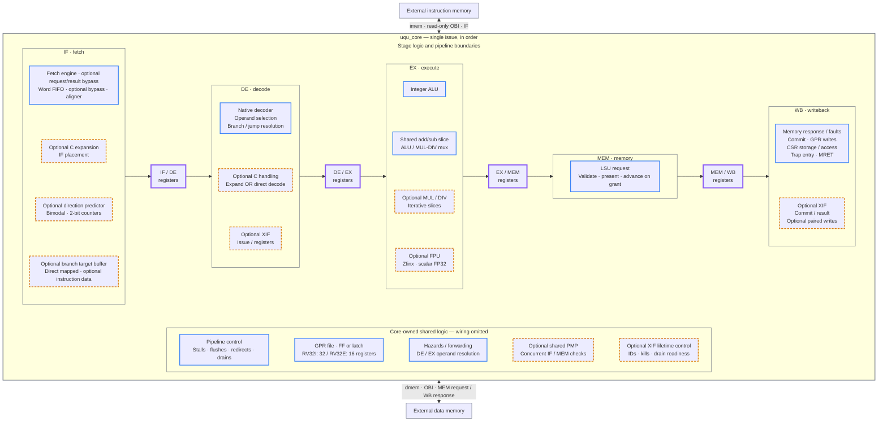
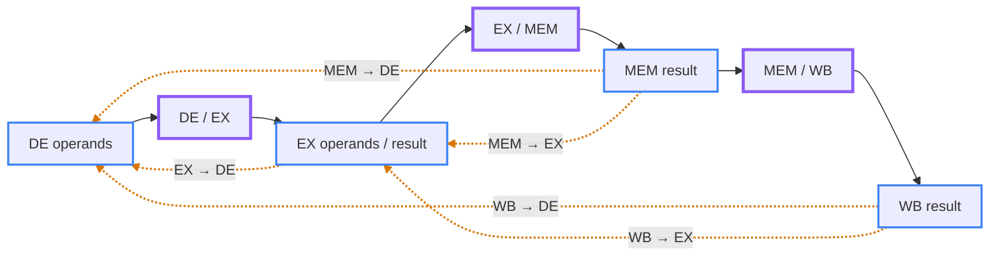

# uquintus

A configurable, single-issue, in-order RV32 RISC-V processor targeting open-source
ASIC flows. The specification is in [doc/uqu_spec.md](doc/uqu_spec.md).

The [native processor core](verif/sim/core/README.md) connects all five stages
with core-owned pipeline registers, hazards, PMP and control. Native execution
supports the implemented E/M/C, M/U, PMP and Zifencei configurations plus the
initial standard-channel XIF profile and scalar Zfinx through CVFPU/FPnew.
Core debug remains unfinished and rejects enabled elaboration.
Hart identity is the 32-bit `HART_ID` elaboration parameter, default zero,
explicitly set in hardware YAML; `mhartid` and CV-X-IF use that constant.
The core testbed includes verification-only RVFI instruction/CSR collectors and SV JSONL trace;
see the [RVFI profile](verif/common/README.md) for coverage and remaining formal work.

## Core structure

Stage regions contain their local logic. The four blocks with thick outlines
are pipeline registers owned by `uqu_core`, outside the stage modules. Each carries
instruction identity, validity and the payload needed by subsequent stages.
The shared region also belongs to the core; CSR storage belongs to WB.



**Legend:** Solid blue outlines = baseline logic, including configurable
implementations; dashed orange outlines = optional hardware; thick violet
outlines = pipeline storage. Fills and text colors follow the viewer's
Mermaid theme.
Solid arrows show stage transfers or the labeled external bus, not every
internal connection. Instruction and data memories are outside the core.

`ISA_C` enables exactly one of three paths: expansion in IF, expansion in DE,
or direct compressed decoding in DE, selected by `MUA_C_IMPL` and
`MUA_C_DECOMPRESS_STAGE`. The two orange C boxes show alternative locations.
`ISA_M`, `ISA_PMP` and `XIF` enable their corresponding blocks. XIF connects an
external coprocessor to DE issue/register and WB commit/result endpoints;
`XIF_DUALWRITE` enables paired writes. The optional FPU path targets scalar FP32
Zfinx (`ISA_ZFINX`).

`MUA_BRANCH_PREDICTOR` selects `none`, `static_not_taken` or `bimodal`.
The [prediction frontend](verif/sim/bpu/README.md) independently
selects target storage with `MUA_BTB: none | direct_mapped`.
`MUA_BP_ENTRIES` sets direction-counter capacity and `MUA_BTB_ENTRIES` sets
target capacity; both default to 16. `config/rv32i_bimodal.yml` explicitly
enables bimodal direction prediction and a direct-mapped BTB. Prediction travels with
the instruction through IF/DE; DE redirects only on an incorrect prediction.
`MUA_BTB_IDATA_HWORDS` optionally retains target instruction sequences (default
`0`), measured in 16-bit halfwords per entry. Without C it must be even;
[rv32i_bimodal_idata.yml](config/rv32i_bimodal_idata.yml) selects eight halfwords
for four I32 instructions. With C, entries and the active replay snapshot pack
encodings automatically. [rv32ic_bimodal_idata.yml](config/rv32ic_bimodal_idata.yml)
demonstrates six halfwords (96 bits), retaining a variable number of whole instructions.
IF replays original encodings with live shared-PMP checks while prefetching the
uncached continuation.

The GPR file remains core-owned while serving DE reads and WB writes. Its
third read port is enabled for three-source XIF or Zfinx.
`MUA_REGFILE_IMPL` selects FF/latch storage; `MUA_DE_OPERAND_RETENTION` selects
optional retention inside the hazard unit. See the
[configuration catalog](doc/uqu_spec.arch.md#2-isa-and-microarchitecture-configuration-parameters)
for all selectors and supported combinations.

### Forwarding paths

All bypasses pass through the core-owned `uqu_hazard`; arrows below show logical
producer-to-consumer routes. The solid chain shows normal pipeline progress.
Orange dashed arrows are configurable bypasses, rather than additional stages.



| Bypass | Enable |
| --- | --- |
| EX → DE | `MUA_FORWARDING && MUA_FORWARD_EX_TO_DE` |
| MEM → DE | `MUA_FORWARDING && MUA_FORWARD_MEM_TO_DE` |
| WB → DE | `MUA_FORWARDING` (no separate path selector) |
| MEM → EX | `MUA_FORWARDING && MUA_FORWARD_MEM_TO_EX` |
| WB → EX | `MUA_FORWARDING && MUA_FORWARD_WB_TO_EX` |

All five routes default to enabled. A matching producer must have a valid,
forwardable result; otherwise the consumer waits or uses a proven EX-bypass
guarantee. Load data becomes forwardable after registering a successful response.
Store data is resolved in EX. Paired XIF results forward only the primary
destination; the secondary waits for register-file visibility. See the
[hazard contract](doc/uqu_spec.arch.md#4-configurable-operand-forwarding).

## Implemented components

| Component | RTL | Verification guide |
| --- | --- | --- |
| Native processor core | [uqu_core.v](src/uquintus/uqu_core.v) | [Core interface and programs](verif/sim/core/README.md) |
| Core pipeline control | [uqu_pipeline_ctrl.v](src/uquintus/uqu_pipeline_ctrl.v) | [Controller interface and tests](verif/sim/pipeline_ctrl/README.md) |
| Core XIF lifetime control | [uqu_xif_ctrl.v](src/uquintus/uqu_xif_ctrl.v) | [ID reservation, cleanup and core tests](verif/sim/xif_ctrl/README.md) |
| Instruction-fetch stage | [uqu_stage_if.v](src/uquintus/uqu_stage_if.v) | [IF interface and tests](verif/sim/if/README.md) |
| Instruction-word fetch engine | [uqu_ifetch.v](src/uquintus/uqu_ifetch.v) | [Ifetch interface and tests](verif/sim/ifetch/README.md) |
| IF word-buffer bypass policy | [uqu_if_bypass.v](src/uquintus/uqu_if_bypass.v) | [Configurable word delivery and tests](verif/sim/if_bypass/README.md) |
| Instruction selection and alignment | [uqu_if_aligner.v](src/uquintus/uqu_if_aligner.v) | [Aligner interface and tests](verif/sim/if_aligner/README.md) |
| Fetched-word buffer | [uqu_if_buffer.v](src/uquintus/uqu_if_buffer.v) | [Buffer interface and tests](verif/sim/if_buffer/README.md) |
| Compressed-instruction expander | [uqu_decompressor.v](src/uquintus/uqu_decompressor.v) | [Decompressor interface and tests](verif/sim/decompressor/README.md) |
| Direct compressed decoder | [uqu_decoder_c.v](src/uquintus/uqu_decoder_c.v) | [Direct decode interface and tests](verif/sim/decode_c/README.md) |
| Decode stage | [uqu_stage_de.v](src/uquintus/uqu_stage_de.v) | [DE interface and tests](verif/sim/de/README.md) |
| Core-owned DE/EX hazards and forwarding | [uqu_hazard.v](src/uquintus/uqu_hazard.v) | [Hazard interface and tests](verif/sim/hazard/README.md) |
| DE branch resolution | [uqu_branch.v](src/uquintus/uqu_branch.v) | [Branch interface and tests](verif/sim/branch/README.md) |
| Native instruction decoder | [uqu_decoder.v](src/uquintus/uqu_decoder.v) | [Decode interface and tests](verif/sim/decode/README.md) |
| General-purpose register file | [uqu_gpregfile.v](src/uquintus/uqu_gpregfile.v) | [Register-file tests and interface](verif/sim/gpregfile/README.md) |
| Architectural CSR register file | [uqu_csregfile.v](src/uquintus/uqu_csregfile.v) | [CSR interface and tests](verif/sim/csregfile/README.md) |
| Load/store unit | [uqu_lsu.v](src/uquintus/uqu_lsu.v) | [LSU interface and tests](verif/sim/lsu/README.md) |
| Memory stage | [uqu_stage_mem.v](src/uquintus/uqu_stage_mem.v) | [MEM interface and tests](verif/sim/mem/README.md) |
| Write-back stage | [uqu_stage_wb.v](src/uquintus/uqu_stage_wb.v) | [WB interface and tests](verif/sim/wb/README.md) |
| Core-owned two-port PMP checker | [uqu_pmp.v](src/uquintus/uqu_pmp.v) | [PMP interface and tests](verif/sim/pmp/README.md) |
| Execute stage | [uqu_stage_ex.v](src/uquintus/uqu_stage_ex.v) | [EX interface and tests](verif/sim/ex/README.md) |
| Base integer ALU | [uqu_alu.v](src/uquintus/uqu_alu.v) | [ALU interface and tests](verif/sim/alu/README.md) |
| Native scalar Zfinx FPU | [uqu_fpu.v](src/uquintus/uqu_fpu.v) | [FPU interface and tests](verif/sim/fpu/README.md) |
| Structural single-cycle multiplier | [uqu_daddamul.v](src/uquintus/uqu_daddamul.v) | [Dadda interface, selection and tests](verif/sim/daddamul/README.md) |
| Native multiply/divide | [uqu_muldiv.v](src/uquintus/uqu_muldiv.v) | [MUL/DIV interface and tests](verif/sim/muldiv/README.md) |
| Shared extended add/sub datapath | [uqu_arith.v](src/uquintus/uqu_arith.v) | [Arithmetic tests and interface](verif/sim/arith/README.md) |

The [native Zfinx FPU adapter](src/uquintus/uqu_fpu.v) instantiates CVFPU/FPnew
with scalar FP32 and 32-bit integer conversions. It supports all 22 decoded
operations, five rounding modes, held results/flags and flush cancellation.
FP state updates at WB retirement. The [interface contract](doc/uqu_spec.arch.md#331-fpu-adapter-interface)
and [FPU tests](verif/sim/fpu/README.md) describe the integration.

`config/rv32i_zfinx.yml` enables it. Six `MUA_FPU_*` settings select internal
register counts, placement and divider backend. TH32 is the default; THMULTI is
also tested. PULP remains blocked on known exception-flag failures. Dependencies
are pinned through Bender without repository submodules; owned RTL remains
Verilog-2005 and imported IP retains SystemVerilog.

Run `bender checkout` to prepare the exact dependencies recorded in `Bender.lock`.
Integer-only runs select owned RTL; the runner includes imported HDL
automatically when a declared dependency selector such as `ISA_ZFINX` is enabled. See the
[dependency guide](doc/uqu_spec.build.md#13-pinned-cvfpu-dependency-without-git-submodules).

Provide Bender, Verilator, GNU Make, a C++ compiler, and the Python dependencies
in `verif/requirements.txt` through your environment. Then run:

```sh
make test COMPONENT=core CONFIG=rv32i
make test COMPONENT=core CONFIG=rv32im
make test COMPONENT=core CONFIG=rv32i_xif
make lint COMPONENT=core CONFIG=rv32i
make sw CONFIG=rv32i RISCV_CC=clang
make test COMPONENT=core_elf CONFIG=rv32i ELF=build/uquintus-rv32i/sw/smoke/program.elf
make test COMPONENT=ifetch CONFIG=rv32i
make test COMPONENT=pipeline_ctrl CONFIG=rv32i
make test COMPONENT=pipeline_ctrl CONFIG=rv32i_zifencei
make test COMPONENT=pipeline_ctrl_parent CONFIG=rv32i_zifencei
make test COMPONENT=if CONFIG=rv32i
make test COMPONENT=if CONFIG=rv32ic
make test COMPONENT=if CONFIG=rv32ic_decompress_de
make test COMPONENT=if CONFIG=rv32ic_decoder_c
make test COMPONENT=if_pipeline CONFIG=rv32ic
make test COMPONENT=ifetch_pmp CONFIG=rv32i_pmp
make test COMPONENT=if_aligner CONFIG=rv32i
make test COMPONENT=if_aligner CONFIG=rv32ic
make test COMPONENT=if_buffer CONFIG=rv32i
make test COMPONENT=if_prefetch CONFIG=rv32ic
make test COMPONENT=decompressor CONFIG=rv32ic
make test COMPONENT=decompressor CONFIG=rv32ic_decompress_de
make test COMPONENT=decompressor CONFIG=rv32ic_decoder_c
make test COMPONENT=decode_c CONFIG=rv32ic_decoder_c
make lint COMPONENT=decompressor CONFIG=rv32ic
make test COMPONENT=decode CONFIG=rv32i
make test COMPONENT=de CONFIG=rv32i
make test COMPONENT=de_pipeline CONFIG=rv32i
make test COMPONENT=branch CONFIG=rv32i
make test COMPONENT=hazard CONFIG=rv32i
make test COMPONENT=hazard CONFIG=rv32i_retained
make test COMPONENT=gpregfile CONFIG=rv32i
make lint COMPONENT=gpregfile CONFIG=rv32i
make test COMPONENT=arith CONFIG=rv32i
make lint COMPONENT=arith CONFIG=rv32i
make test COMPONENT=alu CONFIG=rv32i
make test COMPONENT=lsu CONFIG=rv32i
make test COMPONENT=mem CONFIG=rv32i
make test COMPONENT=mem_pipeline CONFIG=rv32i
make test COMPONENT=wb CONFIG=rv32i
make test COMPONENT=wb_pipeline CONFIG=rv32i
make test COMPONENT=pmp CONFIG=rv32i
make test COMPONENT=csregfile CONFIG=rv32i
make test COMPONENT=ex CONFIG=rv32im
make test COMPONENT=ex_pipeline CONFIG=rv32im
make test COMPONENT=exec_arith CONFIG=rv32im
make test COMPONENT=muldiv CONFIG=rv32im
make test COMPONENT=muldiv CONFIG=rv32im_iterative
```

Use `PYTHON` and `BENDER` to select executables, `TEST=<name>` to select a test
from the component manifest, and `SEED` to reproduce randomized stimulus.
The build does not install dependencies or manage containers.
The optional [ELF program flow](verif/sim/core_elf/README.md) also requires an
external RISC-V GCC or Clang/LLD; directed component/core tests do not.
Run `make clean` to remove the generated `build/` directory.

Run `make report` to collect existing results into
[`build/report/index.html`](build/report/index.html). The static report includes
category pages, searchable run history, logs/results, a configuration matrix and
parameter comparison, plus Markdown/JSON summaries. See the
[reporting guide](scripts/README.md) for outcome/provenance semantics and the
common record used by synthesis and benchmark flows and reserved for formal results. The generated
directory can later be published as a static site; deployment is not configured.

The [riscv-tests integration](verif/sw/riscv_tests/README.md) uses a commit- and
checksum-pinned source archive, without submodules. Fetch explicitly once, then
build/run applicable tests with a supplied compiler:

```sh
make riscv-tests-fetch
make riscv-tests CONFIG=rv32i
make report
```

Compiler discovery uses `RISCV_CC`, `$RISCV/bin` or `PATH`; GCC/Clang identity,
version and effective target are recorded in reports. Use `RISCV_TESTS` for a
partial selection and `CONFIG=rv32im`/`rv32ic` for implemented M/C cases.

The [benchmark ports](verif/sw/benchmark/README.md) provide CoreMark's two seed
profiles and all 19 Embench-IoT 1.0 workloads, with pinned archives and no submodules:

```sh
make benchmark-fetch
make benchmark CONFIG=rv32i
make benchmark-fetch BENCHMARK=embench/embench-iot
make benchmark BENCHMARK=embench/embench-iot CONFIG=rv32imc_bimodal_idata_unroll32
make report
```

Ports and software/memory settings live in `verif/sw/benchmark/<suite>/`.
The default runs validate workload self-checks and report workload cycles,
instructions, CPI and footprint using deterministic memory timing. They are
cycle-only RTL measurements; official benchmark scores are not claimed. See the
[CoreMark guide](verif/sw/benchmark/coremark/README.md) for compiler requirements,
measurement boundaries and artifacts, and the
[Embench guide](verif/sw/benchmark/embench/embench-iot/README.md) for full suite
coverage, software floating-point execution and the RV32IMC BP16/BTB16/H6 preset
with fully unrolled iterative MUL/DIV.

Benchmarks default to `BENCHMARK_MODE=fast`, a native Verilator C++ driver
without cocotb/pyuvm, VPI or instruction tracing during execution. Use
`BENCHMARK_MODE=checked` for the full instruction/RVFI/counter verification path.
Both modes validate the workload self-checks and preserve the same memory/timer contract.
Optional `BENCHMARK_TRACE=1` retains fast-mode retirement records for
[prediction diagnostics](verif/sw/benchmark/embench/embench-iot/README.md#prediction-diagnostics),
including first-kernel versus steady-state history reuse and finite table models.

Compressed decoding uses `MUA_C_IMPL: decompress | decode_compressed` and, for
decompression, `MUA_C_DECOMPRESS_STAGE: if | de`. The three `rv32ic*` profiles
above select the corresponding paths; the default is `decompress/if`.
All hardware configurations explicitly set both selectors, even with C disabled.
IF expansion, DE expansion and direct decoding are implemented. The
[IF/DE fixture](verif/sim/if_pipeline/README.md) checks real stage outputs across
parent-owned boundary storage and feeds accepted DE branch redirects back to IF.
The [core regression](verif/sim/core/README.md) covers these paths in the
integrated five-stage pipeline with its shared controller, hazards and PMP.

Make invokes the shared component-testing helper in
[verif/sim/common/](verif/sim/common/README.md). Component-specific DUT and test
settings live in `config/sim/<component>.yml`; examples are
[decompressor.yml](config/sim/decompressor.yml), [decode_c.yml](config/sim/decode_c.yml), [de.yml](config/sim/de.yml), [de_pipeline.yml](config/sim/de_pipeline.yml),
[ifetch.yml](config/sim/ifetch.yml), [ifetch_pmp.yml](config/sim/ifetch_pmp.yml),
[if_aligner.yml](config/sim/if_aligner.yml),
[if_buffer.yml](config/sim/if_buffer.yml), [if_prefetch.yml](config/sim/if_prefetch.yml),
[if.yml](config/sim/if.yml), [if_pipeline.yml](config/sim/if_pipeline.yml),
[pipeline_ctrl.yml](config/sim/pipeline_ctrl.yml), [pipeline_ctrl_parent.yml](config/sim/pipeline_ctrl_parent.yml),
[hazard.yml](config/sim/hazard.yml), [branch.yml](config/sim/branch.yml), [decode.yml](config/sim/decode.yml), [gpregfile.yml](config/sim/gpregfile.yml), [arith.yml](config/sim/arith.yml),
[alu.yml](config/sim/alu.yml), [muldiv.yml](config/sim/muldiv.yml),
[exec_arith.yml](config/sim/exec_arith.yml), [ex.yml](config/sim/ex.yml),
[ex_pipeline.yml](config/sim/ex_pipeline.yml), [lsu.yml](config/sim/lsu.yml),
[pmp.yml](config/sim/pmp.yml), [csregfile.yml](config/sim/csregfile.yml),
[mem.yml](config/sim/mem.yml), [mem_pipeline.yml](config/sim/mem_pipeline.yml),
[wb.yml](config/sim/wb.yml), and [wb_pipeline.yml](config/sim/wb_pipeline.yml).
The CSR component supports optional U/C/PMP/Zfinx/debug state. WB supports
standard CV-X-IF commit/results, paired writes and debug execution endpoints.
Use [rv32i_xif_debug.yml](config/rv32i_xif_debug.yml) to exercise both optional WB
features (`make test COMPONENT=wb CONFIG=rv32i_xif_debug`). To test enabled PMP matching, use a complete
hardware configuration with `ISA_PMP: 1`; `rv32i` tests its disabled bypass.
The [rv32i_pmp preset](config/rv32i_pmp.yml) enables the checker for reproducible
PMP/CSR tests and the [shared IF/LSU fixture](verif/sim/ifetch_pmp/README.md).
The [prefetch fixture](verif/sim/if_prefetch/README.md) connects the actual
fetcher, word FIFO and aligner, checking capacity reservation, mixed-length
instruction reuse, fault containment and redirects under stalls.
The [controller parent fixture](verif/sim/pipeline_ctrl_parent/README.md) adds
actual boundary registers and MEM/WB units for interrupt/CSR re-evaluation,
precise fault containment, LSU effect permission and remembered fence handshakes.
Use `make test-runner` to
check the shared tooling without running an HDL simulator.

The native processor, scalar Zfinx FPU and initial XIF integration are implemented. Core debug
integration, complete architectural verification, formal proofs and physical
implementation remain unfinished. Mapped ASIC synthesis is available below.

Optional [Spike differential checking](verif/reference/README.md) is available for
ELF runs and riscv-tests through `REFERENCE=spike`. Supply the pinned external
binary through `SPIKE`, `$RISCV/bin` or `PATH`.

Directed Zfinx ISA checks use `SW=zfinx CONFIG=rv32i_zfinx` with the ELF
runner and `REFERENCE=spike`; see the [reference guide](verif/reference/README.md#scalar-zfinx-isa-checks).

## ASIC synthesis

The [ORFS synthesis flow](impl/asic/README.md) consumes the same hardware YAML
and Bender sources as simulation. Supply `ORFS_ROOT`, `YOSYS_EXE` and
`OPENROAD_EXE` externally; enabled Zfinx also needs the compatible Slang plugin.
`ASIC_FLOW` defaults to `orfs`; its scripts and platform adapters live under
`impl/asic/orfs/`, leaving room for other implementation flows alongside it.

```sh
make synth ASIC_FLOW=orfs CONFIG=rv32i TOP=core PLATFORM=sky130hd
make synth CONFIG=rv32i_zfinx TOP=fpu PLATFORM=sky130hd
make synth CONFIG=rv32i_zfinx TOP=core PLATFORM=ihp-sg13g2
make impl CONFIG=rv32i_zfinx TOP=core PLATFORM=ihp-sg13g2 RESET_INPUT_DELAY_NS=1
make report
```

`CLOCK_PERIOD_NS=20` is the default exploratory target. Results include mapped
cell counts/area and preplacement timing, with structural and full-mapping
checks. Passing synthesis does not establish timing closure. The
baseline enables ABC wire-load estimates and configures synthesis-buffer removal
before timing-driven placement; each run retains the policy and ABC script hash.
The [IHP placement comparison](impl/asic/orfs/investigations/ihp-placement.md) also provides
two controlled placed results. `make impl` now runs current RTL through placement
and timing repair, with scoped critical-path tables in the report. Supply
`SDC=<file>` for caller-provided constraints; omit the reset-delay override in
that case. CTS, routing and extracted power/timing remain open.
The [benchmarking specification](doc/uqu_spec.bench.md) defines `T_min` and
estimated maximum frequency with their measurement assumptions.
