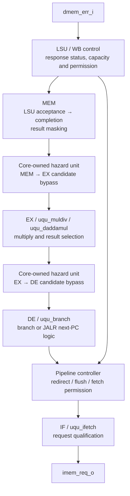

# Why data-memory responses appear on the instruction-request critical path

This audit follows the first `full_max.rpt` path in both placed RV32IMC/divider-1
multiplier comparisons. It distinguishes the real architectural control
relationship from the much longer structural paths reported by STA.

This describes the pre-cleanup netlists. The subsequent
[candidate-data cleanup](result-data-separation.md) implements the separation
recommended below and records its functional/structural validation.

The connection is **LSU/WB completion and fault control, followed by data
qualification and forwarding**. The reported paths also cross the EX multiplier
and DE control-flow logic. Describing them only as control paths was incomplete.

## The legitimate connection between the buses

`uqu_lsu` consumes a data response for an older operation now owned by WB.
A successful response can complete WB and free capacity for the next MEM
request in the same clock. An error must block younger effects and initiate
precise exception recovery. See `uqu_lsu.v:79–87`, `uqu_stage_wb.v:140–141` and
`uqu_pipeline_ctrl.v:155–169`.

Those decisions also control IF: whether a younger instruction may advance,
whether the current instruction stream is invalidated, and whether a **new**
instruction request may be presented. The IF address can remain registered
while the request enable depends combinationally on those decisions.
`uqu_ifetch` retains an already presented OBI request through grant; cancellation
of private/new fetch work does not withdraw that presented transaction.

Loads still become forwardable only after response registration. WB explicitly
requires `!lsu_i || lsu_res_registered_i` in `result_valid_o`. The long traces
below do not demonstrate a supported live-load-data bypass.

## Structural route through the Dadda configuration

The path starts with the live response error, reaches qualification of a
new MEM request/result, then enters the forwarding/data cones:



Arrows describe a **structural timing route**, not an instruction sequence that
can exercise every arrow at once. The last shortcut represents the genuine
shorter response/fault control relationship.

| Part | RTL role |
| --- | --- |
| LSU | `capacity = !pending_q || (pending_done && !response_error)` allows a successful old response to overlap a new grant; an error blocks that overlap. |
| MEM | For a load/store, `valid_o` can depend on `lsu_req_fire`. `result_o` is forced to zero when the slot is incomplete or faulting. Its underlying `result_i` is the core-owned `mem_data_q`; for an LSU operation that word contains the effective address. |
| Hazard / MEM→EX | A candidate result passes through the operand-resolution mux. Actual use requires `mem_forwardable`, including **`!mem_lsu_q`**. |
| EX | The candidate operand enters the multiplier tree and the selected MUL/DIV result. The first HA/FA cones on these paths have no divider-state inputs; they belong to multiplication, not the iterative DIV chain. |
| Hazard / EX→DE | EX result can feed a DE control-flow operand in the same clock when that forwarding option is enabled. |
| DE | Branch comparison or JALR target addition produces the corrected next PC. The core compares that against the predicted next PC to decide recovery. |
| Controller and IF | An accepted redirect/fault changes fetch permission and invalidation; these qualify `uqu_ifetch.direct_request` and new queued-request presentation. `imem_req_o` is the OR of queued and direct requests. |

The comparison uses `MUA_REDIRECT_BYPASS: none`. The final connection therefore
includes suppression/cancellation of the old stream's request; it does not
mean the new branch target address is issued combinationally that cycle.

Useful source locations:

- [LSU response/capacity](../../../../src/uquintus/uqu_lsu.v): lines 79–103.
- [MEM completion and data masking](../../../../src/uquintus/uqu_stage_mem.v): lines 72–83.
- [Core producer qualification](../../../../src/uquintus/uqu_core.v): `mem_forwardable` and `ex_forwardable`.
- [Operand resolution](../../../../src/uquintus/uqu_hazard.v): MEM→EX at lines 200–205, EX→DE at lines 157–162.
- [DE control flow](../../../../src/uquintus/uqu_branch.v): operand comparison and target addition.
- [Pipeline control](../../../../src/uquintus/uqu_pipeline_ctrl.v): lines 155–169 and 184–188.
- [IF request generation](../../../../src/uquintus/uqu_ifetch.v): lines 67–75 and 105.

## What makes the reported long route pessimistic

For the Dadda path, reaching `mem_result[8]` along this particular route
requires **`mem_lsu_q=1`**: response-dependent LSU acceptance qualifies the MEM
word. But forwarding that MEM word into EX requires **`mem_lsu_q=0`**. A MEM
load/store address must never be used as the destination-register result.
The two conditions cannot hold together.

This is visible in the RTL:

```verilog
// MEM completion has an LSU acceptance case.
valid_o = active && (exception_valid_i || !lsu_i ||
                     lsu_exception_valid || issued_q || lsu_req_fire);
result_o = !valid_o || exception_valid_o ? 32'd0 : result_i;

// Core qualification excludes LSU instructions from MEM forwarding.
mem_forwardable = mem_complete && !mem_exception && !mem_lsu_q &&
                  (mem_kind_q == UQU_WB_RESULT);
```

STA traverses the connectivity and cell timing arcs without resolving all of
these Boolean correlations. It consequently follows the masked address/result
word as a potential forwarded operand, through multiplication and control-flow
logic, although the relevant producer is disallowed by its instruction class.

The inferred-multiplier path starts with `dmem_rvalid_i`. Its first blocked
prefix lies earlier, in WB/controller completion/fault qualification. That
prefix requires a WB LSU operation, no buffered response and `dmem_err_i=1`.
A live error response and safe successful WB release are correlated; the
reported continuation does not have a stable sensitizing assignment. Its
later structural path likewise contains EX multiplication and DE/IF logic.

## Gate-level sensitization checks

The checks use the actual **placed** Verilog and Sky130 liberty Boolean models,
not an assumed correspondence between renamed gates and RTL. The first path
has 120 distinct net points for Dadda and 121 for inferred multiplication.

For each path, the audit:

1. Parses the placed netlist with Yosys 0.63 and extracts its combinational
   ancestor cone, stopping at primary inputs and clocked-register outputs.
2. Makes two copies with every other boundary value shared. Register outputs
   are unconstrained shared inputs, without reachability/reset assumptions.
   Only the reported source changes between 0 and 1.
3. Asks whether **every net point on the reported path changes**. Both cases
   are UNSAT: there is no such stable assignment, even allowing arbitrary
   register contents.
4. Separately asks whether the source can change `imem_req_o` at all. Both
   cases are SAT, confirming that the port pair still has a functional dependency.
5. Binary-searches the first unsensitizable prefix and checks its guards.

| Check | Dadda | Inferred parallel |
| --- | --- | --- |
| Entire first reported path can change end-to-end in two stable snapshots | UNSAT | UNSAT |
| Source can change the endpoint through some logic route | SAT | SAT |
| Last sensitizable path prefix | Through point 17, `mem_result[8]` | Through point 7, `_07265_` |
| First blocked extension | Point 18, `_31084_/Y` / `_09577_` | Point 8, `_30672_/Y` / `_07340_` |

Additional Dadda checks establish that the 17-point prefix needs `mem_lsu_q=1`,
while the next gate's MEM bypass term (`_31084_/B2`) cannot be enabled with that
bit set, in either snapshot. Additional inferred checks establish that its
7-point prefix needs WB LSU=1, response-buffer-valid=0 and data-error=1.

The extracted cones contain 13,728 and 15,191 combinational cells, respectively,
with 3,679 free/shared boundary bits each. Raw models, scripts, prefix checks
and SAT logs are retained under
[`build/investigations/memory-fetch-path/`](../../../../build/investigations/memory-fetch-path/).
The audit JSON records hashes of the placed netlists, timing reports and library.

These are **stable Boolean sensitization checks**, not a proof of timed hazard
freedom or a full sequential core proof. Reconvergent transient behavior and
clocked observation still need assessment before any timing waiver. No false
path, multicycle exception or RTL change was applied. A blanket false path
between the memory inputs and `imem_req_o` would hide the real shorter control
relationship demonstrated by the SAT endpoint check.

## Implication for the earlier comparison and next implementation work

The original runs still fail their current STA constraints, and their area and
raw slack measurements are unchanged. However, the quoted 30.885/32.346 ns
period estimates are dominated by these structurally pessimistic routes;
they do not establish the true functional maximum frequency or prove that a
20 ns implementation is impossible. Other paths remain to be audited.

A useful structural cleanup is to separate **candidate data** from
**availability, exception and transfer control**. In particular, avoid putting
LSU acceptance and global valid/fault masking onto ordinary MEM bypass data.
Select raw candidate payloads using registered producer identity; separately
qualify readiness, advancement, side effects and retirement. EX/FU result
masking and hazard mux qualification need the same review. Preserve precise
exceptions and the registered-only load-forwarding rule.

That approach can remove the artificial excursions into wide arithmetic
without adding a pipeline cycle. After such a change, rerun functional tests
and the matched physical comparison. Inserting another multiplier stage or
loosening the whole port-pair constraint is not justified by these traces.
